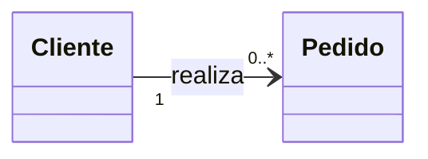
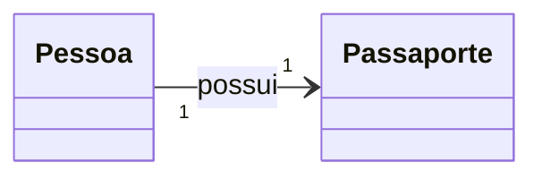
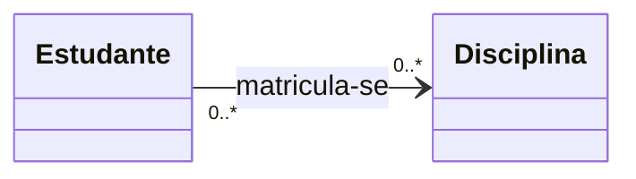
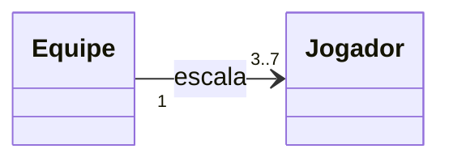

---
layout: section
index: "T"
title: "Teoria"
---

---
layout: define
term: Multiplicidade
definition: "Define a quantidade mínima e máxima de objetos de uma classe que podem estar associados a um objeto de outra classe."
---

---
layout: default
title: Uma pergunta
---

**Quantos objetos de uma classe podem se relacionar com um objeto de outra classe?**

Essa é a pergunta respondida pela multiplicidade.

---
layout: diagram
title: Cliente e pedido
---



---
layout: table
title: Tipos de multiplicidade
---

| Tipo | Notação comum |
|---|---|
| Um para um | `1:1` |
| Um para muitos | `1:N` |
| Muitos para muitos | `N:N` |

<!-- ---
layout: section
index: "1:1"
title: "Um para um"
--- -->

---
layout: define
term: Um para um (1:1)
definition: "Cada objeto de uma classe se associa a, no máximo, um objeto da outra classe; a relação inversa também é um para um."
---

---
layout: diagram
title: Pessoa e Passaporte
kicker: Exemplo
---



<!-- ---
layout: section
index: "1:N"
title: "Um para muitos"
--- -->

---
layout: define
term: Um para muitos (1:N)
definition: "Um objeto de uma classe pode se associar a vários objetos da outra classe; cada um deles se associa a um objeto do primeiro lado."
---

---
layout: diagram
title: Cliente e Pedidos
kicker: Exemplo
---


<!-- ---
layout: section
index: "N:N"
title: "Muitos para muitos"
--- -->

---
layout: define
term: Muitos para muitos (N:N)
definition: "Vários objetos de cada classe podem se associar a vários objetos da outra classe."
---

---
layout: diagram
title: Estudante e Disciplina
kicker: Exemplo
---



---
layout: default
title: Limites da multiplicidade
---

A multiplicidade pode indicar uma quantidade mínima e máxima.

- `3..7`: pelo menos 3 e no máximo 7 objetos
- `1..5`: pelo menos 1 e no máximo 5 objetos

---
layout: diagram
title: Equipe e Jogadores
kicker: Exemplo
---



---
layout: section
title: Desenvolvimento
index: D
---

---
layout: default
title: PDV
---

Modele e implemente as relações entre **Cliente**, **Pedido** e **Produto**.

- Um cliente pode realizar zero ou muitos pedidos.
- Um pedido é feito por zero ou muitos clientes. 
- Um pedido contém zero ou muitos produtos.
- Um produto pertence a zero ou muitos pedidos. 
<!-- 
---
layout: code
title: Um ponto de partida em Java
---

```java[font=large]
class Cliente {
  private Carrinho carrinhoAtivo; // 0..1
  private List<Pedido> pedidos = new ArrayList<>(); // 0..*
}

class Carrinho {
  private Cliente cliente; // 1
  private List<Produto> produtos = new ArrayList<>(); // 0..*
}

class Pedido {
  private Cliente cliente; // 1
}
```

Implemente operações que mantenham as referências coerentes nos dois lados. -->

---
layout: section
title: Hands-On
index: H
---

---
layout: default
title: Desafios por domínio
---

Em cada domínio, desenhe o diagrama, implemente as associações em Java e teste os limites mínimo e máximo.

- **Concessionária:** concessionária e carros; cliente e test drives.
- **Biblioteca:** usuário e empréstimos; empréstimo e exemplares.
- **Sistema bancário:** cliente e contas; conta e titulares (considere conta conjunta).
- **Mensagens:** conversa e participantes; conversa e mensagens.
<!-- 
---
layout: code
title: Exemplo de implementação
---

```java[font=large]
class Conversa {
  private final List<Usuario> participantes = new ArrayList<>();
  private final List<Mensagem> mensagens = new ArrayList<>();

  void adicionarParticipante(Usuario usuario) {
    if (!participantes.contains(usuario)) {
      participantes.add(usuario);
    }
  }
}
```

Defina as multiplicidades, evite associações duplicadas e escreva testes para cada regra. -->
<!-- 
---
layout: default
title: Referências
---
<BiblioList /> -->

---
layout: feature
kicker: Encerramento
title: Obrigado!
columns: 2
features:

- { icon: "lucide:globe", desc: filipefernandesphd.com }
- { icon: "lucide:instagram", desc: "@filipfernandesphd" }

---

---
layout: two-cols
title: Avaliação da Experiência de Aprendizagem
---

- **[Seu feedback é muito importante!](https://forms.gle/CMfL5oTm235FfuH59)**
- Obtenha o código da avaliação

::right::


