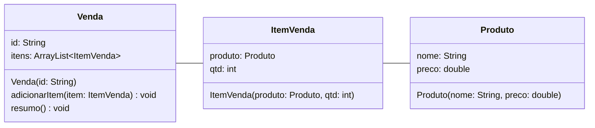
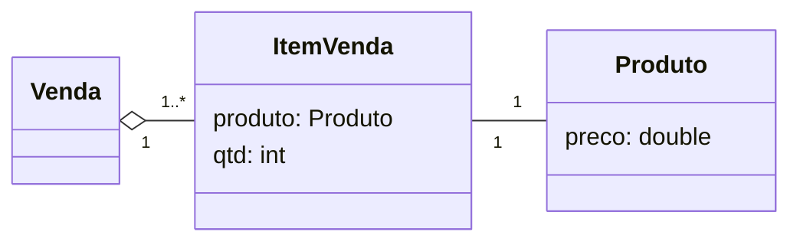
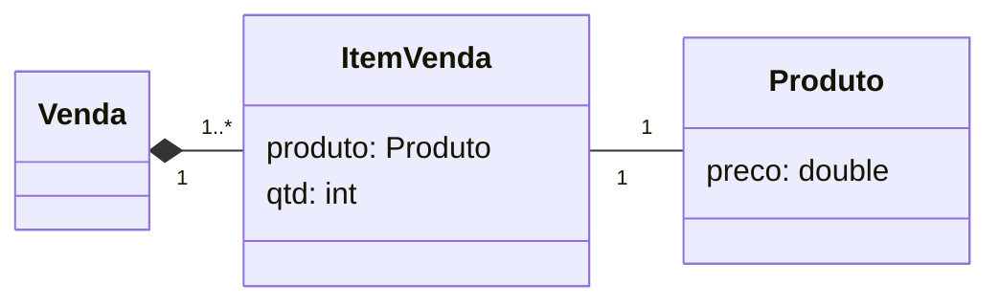

---
layout: section
index: "T"
title: "Teoria"
---

<!-- ---
layout: diagram
kicker: "Visão Geral"
---


---
layout: section
title: Agregação
index: "01"
---

---
layout: diagram
title: "Agregação"
---


---
layout: code
kicker: Código Agregação
---
```java[font=large]
// Main.java
Produto p1 = new Produto("Calça", 300.99);
Produto p2 = new Produto("Blusa", 59.9);

Venda v1 = new Venda("001");

ItemVenda item1 = new ItemVenda(p1,1);
ItemVenda item2 = new ItemVenda(p2,3);

v1.adicionarItem(item1);
v1.adicionarItem(item2);

v1.resumo();
```

---
layout: code
kicker: Código Agregação (cont.)
---
```text[font=extralarge]
// Output do Main.java
Resumo da venda 001

Calça		1		300.99
Blusa		3		179.7
Total:				480.69
```

---
layout: code
kicker: Código Agregação (cont.)
---
```java[font=extralarge]
// Main.java
// ...
v1.resumo();

// Testar efeito da agregação
v1 = null;

// verificação ...
```

---
layout: code
kicker: Código Agregação (cont.)
---
```text[font=extralarge]
// Output do Main.java
Resumo da venda 001

Calça		1		300.99
Blusa		3		179.7
Total:				480.69

v1 não existe, mas os itens ainda existem!
Isso é agregação!
```

---
layout: default
title: Conclusão
kicker: Agregação
---
- Relacionamento **todo-parte**.
- Quando o **todo** não exite, mas a **parte** continua existindo.

---
layout: section
title: Composição
index: "02"
---

---
layout: diagram
title: "Composição"
---


---
layout: code
kicker: Código Composição
---
```java[font=large]
// Main.java
Produto p1 = new Produto("Calça", 300.99);
Produto p2 = new Produto("Blusa", 59.9);

Venda v1 = new Venda("001");

v1.adicionarItem( new ItemVenda(p1, 1) );
v1.adicionarItem( new ItemVenda(p2, 3) );

v1.resumo();
```

---
layout: code
kicker: Código Composição (cont.)
---
```text[font=extralarge]
// Output do Main.java
Resumo da venda 001

Calça		1		300.99
Blusa		3		179.7
Total:				480.69
```

---
layout: code
kicker: Código Composição (cont.)
---
```java[font=extralarge]
// Main.java
// ...
v1.resumo();

// Testar efeito da agregação
v1 = null;

// verificação ...
```

---
layout: code
kicker: Código Composição (cont.)
---
```text[font=extralarge]
// Output do Main.java
Resumo da venda 001

Calça		1		300.99
Blusa		3		179.7
Total:				480.69

v1 não existe e também os itens!
Isso é composição!
```

---
layout: default
title: Conclusão
kicker: Composição
---
- Relacionamento **todo-parte**.
- Quando o **todo** não exite, a **parte** também deixa de existir.

---
layout: section
title: Desenvolvimento
index: "D"
---

---
layout: default
title: Desenvolvimento
---
- Implemente as classes **Venda**, **ItemVenda** e **Produto**.
- Teste a implementação com agregação e com composição.

---
layout: section
title: Hands-On
index: "H"
---

---
layout: default
title: Hands-On
---
- Considere os domínios **Sistema de Biblioteca**, **Sistema Bancário**, **App de Mensagens** e **E-Commerce**
- Identifique oportunidades de agregação e composição e implemente-os.

---
layout: feature
kicker: Encerramento
title: Obrigado!
columns: 2
features:

- { icon: "lucide:globe", desc: filipefernandesphd.com }
- { icon: "lucide:instagram", desc: "@filipfernandesphd" }

---

---
layout: two-cols
title: Avaliação da Experiência de Aprendizagem
---

- **[Seu feedback é muito importante!](https://forms.gle/CMfL5oTm235FfuH59)**
- Obtenha o código da avaliação

::right::


