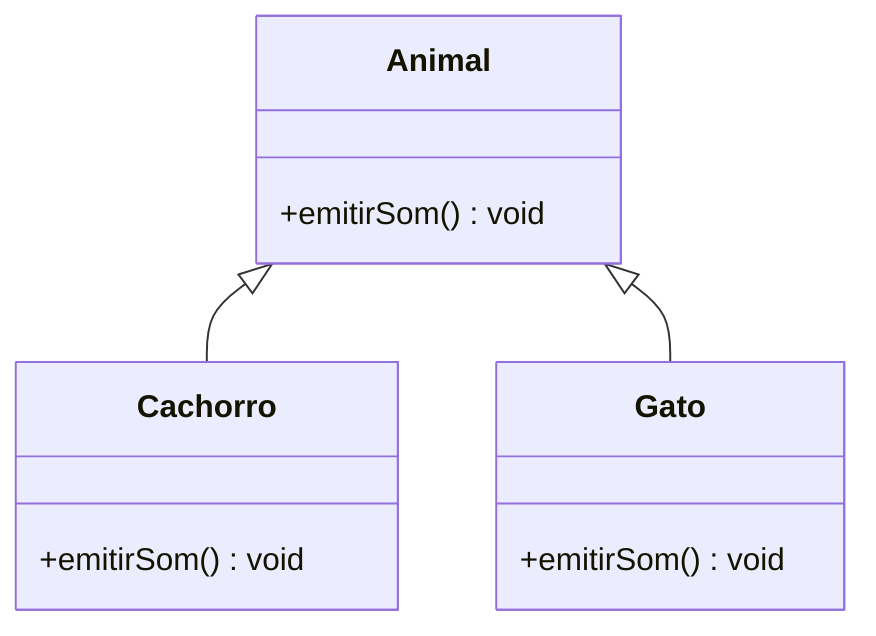
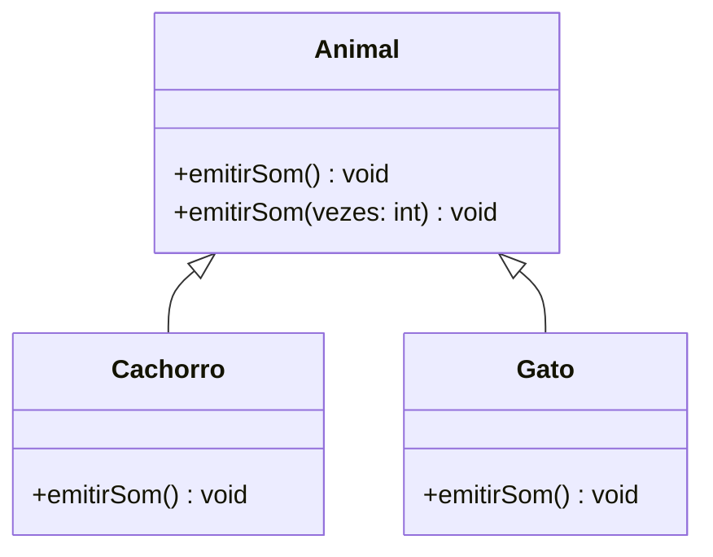
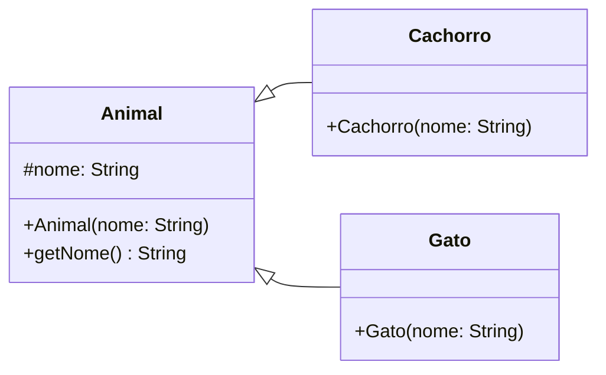

---
layout: agenda
title: Agenda
items:
  - { topic: Polimorfismo }
  - { topic: Sobrescrita }
  - { topic: Sobrecarga }
  - { topic: super }
---

---
layout: section
index: "T"
title: "Teoria"
---
---
layout: section
title: "Polimorfismo"
index: "01"
---
---
layout: quote
title: "Polimorfismo"
quote: Permitir que diferentes objetos respondam à mesma operação de maneiras distintas
author: Filipe Fernandes, Ph.D.
---

---
layout: diagram
kicker: Polimorfismo
---


---
layout: code
kicker: Polimorfismo
---
```java[font=normal]
class Animal {   
  void emitirSom() {
      System.out.println("Som de animal");
  }
}

class Cachorro extends Animal {
  void emitirSom() {
      System.out.println("Au au");
  }
}

class Gato extends Animal {
  void emitirSom() {
      System.out.println("Miau");
  }
}
```


---
layout: code
kicker: Polimorfismo
---

<!-- ```java[font=large]
// Main.java
public class Main {
    public static void main(String[] args) {
        Animal[] animais = {
            new Cachorro(), new Gato(), new Animal()
        };

        for (Animal animal : animais) {
            animal.emitirSom();
        }
    }
}
``` -->
```java[font=extralarge]
// Main.java
Animal animal = new Animal("Animal");
animal.emitirSom();

Cachorro cachorro = new Cachorro("Pluto");
cachorro.emitirSom();

Gato gato = new Gato("Tom");
gato.emitirSom();
```

---
layout: code
kicker: Polimorfismo
---
Saída:
```text[font=extralarge]
Som de animal
Au au
Miau
```
---
layout: section
title: "Sobrescrita"
index: "02"
---
---
layout: quote
title: "Sobrescrita"
quote: Método herdado com a mesma assinatura e implementação própria.
author: Filipe Fernandes, Ph.D.
---

---
layout: code
kicker: Polimorfismo
---

`Cachorro` e `Gato` sobrescrevem o método `emitirSom` de `Animal`.

```java[font=normal]
class Animal {   
  void emitirSom() { /* ... */ }
}

class Cachorro extends Animal {
  void emitirSom() {
      System.out.println("Au au");
  }
}

class Gato extends Animal {
  void emitirSom() {
      System.out.println("Miau");
  }
}
```

---
layout: default
title: @Override
---

- Notação para explicitar a sobrescrita de métodos.
- **Não é obrigatória**, mas melhora a legibildade e força a verificação em tempo de compilação. 

```java[font=extralarge]
@Override
void emitirSom() { /* */ }
```


---
layout: section
title: "Sobrecarga"
index: "03"
---
---
layout: quote
title: "Sobrecarga"
quote: Método com mesmo nome, mas com <span class="accent2">parâmetros diferentes</span>.
author: Filipe Fernandes, Ph.D.
---
---
layout: diagram
---


---
layout: code
kicker: Sobrecarga
---

```java[font=large]
// Animal.java
public class Animal {
  public void emitirSom() { /* */ }

  public void emitirSom(int vezes) {
      for (int i = 0; i < vezes; i++) {
          this.emitirSom();
      }
  }
}
```
---
layout: code
kicker: Sobrecarga
---
```java[font=extralarge]
Animal cachorro = new Cachorro();
cachorro.emitirSom();     // Au au
cachorro.emitirSom(2);    // Au au, Au au

Animal gato = new Gato();
gato.emitirSom(2);        // Miau, Miau
```

---
layout: default
title: "Sobrescrita <i>x</i> Sobrecarga"
---

| Aspecto | Sobrescrita | Sobrecarga |
|---|---|---|
| Onde | Subclasse redefine método herdado | Mesmo nome, parâmetros diferentes |
| Assinatura | Mantida | Alterada |
| Seleção | Tempo de execução | Tempo de compilação |
| Exemplo | `Cachorro.emitirSom()` | `Animal.emitirSom()` e `Animal.emitirSom(int)` |


---
layout: section
title: "super"
index: "04"
---
---
layout: quote
title: "super"
quote: Permite acessar partes herdadas da superclasse.
author: Filipe Fernandes, Ph.D.
---

---
layout: default
title: "super"
---

<v-clicks>

- `super(...)` chama um **construtor** da superclasse.
- `super.atributo` acessa um **atributo** herdado visível.
- `super.metodo()` chama a implementação herdada de um **método**.

</v-clicks>

<!-- ---
layout: default
title: "Onde usar super"
---

- **Construtor:** inicializar a parte herdada do objeto com `super(...)`.
- **Atributo:** distinguir um campo herdado de outro com o mesmo nome na subclasse.
- **Método:** executar a implementação da superclasse dentro de uma sobrescrita.

Atributos e métodos `private` da superclasse não podem ser acessados diretamente por `super`.
---
layout: default
title: "super() em construtores"
---

Em um construtor de subclasse, `super(...)` chama um construtor da superclasse para inicializar a parte herdada do objeto.

- Deve ser a **primeira instrução** do construtor.
- Os argumentos escolhem qual construtor da superclasse será chamado.
- Sem chamada explícita, Java tenta inserir `super()`; isso exige um construtor sem parâmetros na superclasse. -->

---
layout: diagram
kicker: super no construtor
---



---
layout: code
kicker: super no construtor
---
```java[font=large]
class Animal {
    protected String nome;
    Animal(String nome) { this.nome = nome; }
    String getNome() { return nome; }
}

class Cachorro extends Animal {
    Cachorro(String nome) { super(nome); }
}

class Gato extends Animal {
    Gato(String nome) { super(nome); }
}
```

---
layout: code
kicker: super no construtor
---
```java[font=extralarge]
// Main.java
Cachorro cachorro = new Cachorro("Pluto");
System.out.println(cachorro.getNome()); 

Gato gato = new Gato("Tom");
System.out.println(gato.getNome());
```

```text[font=large]
Tom
Pluto
```

---
layout: section
title: Atenção!
---

---
layout: default
title: "Sobrecarga e Sobrescrita em Construtores"
---

<v-clicks>

- Pode ter **sobrecarga** de construtores?
- **SIM!**

</v-clicks>

<v-clicks>

```java[font=large]
class Animal {
  protected String nome;
  Animal() { this.nome = "Sem nome"; }
  Animal(String nome) { this.nome = nome; }
}
```

</v-clicks>


---
layout: default
title: "Sobrecarga e Sobrescrita em Construtores"
---

<v-clicks>

- Pode ter **sobrescrita** de construtores?
- **NÃO!**
- Construtores não são herdados. Eles são chamados!

</v-clicks>

<v-clicks>

```java[font=large]
class Cachorro {
  Cachorro(String nome) { super(nome); }
}
```

</v-clicks>


<!-- **Sobrecarga: sim.** Uma classe pode declarar construtores com listas de parâmetros diferentes.

```java[font=large]
class Animal {
    private final String nome;
    Animal() { this("Sem nome"); }
    Animal(String nome) { this.nome = nome; }
}
```

**Sobrescrita: não.** Construtores não são herdados. `Cachorro(String nome)` é um construtor da subclasse que chama `super(nome)`, não uma sobrescrita de `Animal(String nome)`. -->

---
layout: quote
title: super em atributos
quote: Acessa o atributo <span class="accent2">visível</span> declarado na superclasse.
author: Filipe Fernandes, Ph.D.
---

<!-- - `super.atributo` acessa o atributo **visível** declarado na superclasse. -->


<!-- `super.nome` acessa o atributo **visível** declarado na superclasse. `this.nome` acessa o atributo declarado na subclasse quando os nomes coincidem.

Essa distinção aparece no **sombreamento de atributos**. Em projetos reais, prefira nomes distintos ou métodos de acesso para evitar confusão. -->
---
layout: code
kicker: super em atributo
---

```java[font=large]
class Animal {
  protected String nome;
  Aninal (String nome) { this.nome = nome; }
}

class Cachorro extends Animal {
  Cachorro (String nome) { super(nome); }
  void mostrarNomes() {
      System.out.println(super.nome);     // nome da classe Animal
      System.out.println(this.nome);      // nome da classe Cachorro
  }
}
```

<!-- <v-clicks>

```text
Animal
Pluto
```

</v-clicks> -->

<!-- `super.nome` lê o campo de `Animal`; `this.nome`, o de `Cachorro`. -->


---
layout: quote
title: super em métodos
quote: Acessa o método <span class="accent2">visível</span> declarado na superclasse.
author: Filipe Fernandes, Ph.D.
---

---
layout: code
kicker: super em métodos
---

```java[font=large]
class Animal {
  void emitirSom() { System.out.println("Som de animal"); }
}
class Cachorro extends Animal {
  // ...
  @Override
  void emitirSom() {
      super.emitirSom();
      System.out.println("Au au");
  }
}
```

<v-clicks>

```text
Som de animal
Au au
```

</v-clicks>


---
layout: section
title: "Desenvolvimento"
index: "D"
---
---
layout: default
title: "Desenvolvimento"
---

No **PDV**, implemente a finalização de uma venda com pagamento simulado:

- `FormaPagamento.processar(double valor)` define a operação comum.
- `PagamentoPix` e `PagamentoDinheiro` sobrescrevem `processar` com saídas distintas.
- `Venda` oferece `finalizar(FormaPagamento)` e `finalizar(FormaPagamento, Cliente)`.
- Teste as duas assinaturas com os dois pagamentos. Identifique o cliente apenas na segunda.
---
layout: section
title: "Hands-on"
index: "H"
---
---
layout: default
title: "Hands-on"
---

**Implemente os quatro sistemas em Java:**

| Sistema | Funcionalidade |
|---|---|
| Biblioteca | Empréstimo de diferentes tipos de itens |
| E-commerce | Cálculo de frete |
| Mensagens | Envio de diferentes tipos de mensagens |
| Banco | Cálculo de tarifas por tipo de conta |

Em **cada sistema**, crie uma superclasse, duas subclasses, um método sobrescrito com `@Override` e duas assinaturas sobrecarregadas. Demonstre chamadas por referências do supertipo. Entregue diagrama de classes, código e saída de execução.
---
layout: feature
kicker: Encerramento
title: Obrigado!
columns: 2
features:

- { icon: "lucide:globe", desc: filipefernandesphd.com }
- { icon: "lucide:instagram", desc: "@filipfernandesphd" }

---
---
layout: two-cols
title: Avaliação da Experiência de Aprendizagem
---

- **[Seu feedback é muito importante!](https://forms.gle/CMfL5oTm235FfuH59)**
- Obtenha o código da avaliação

::right::


